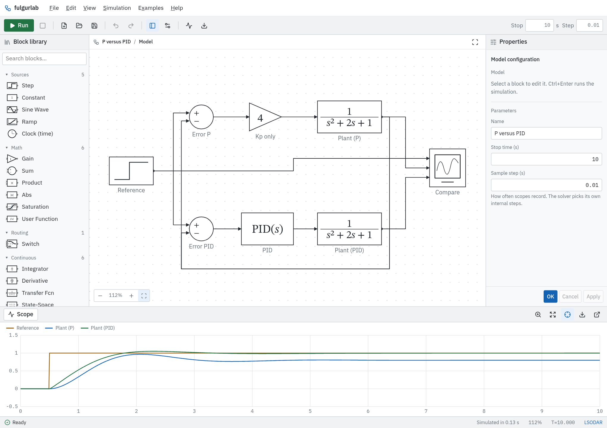
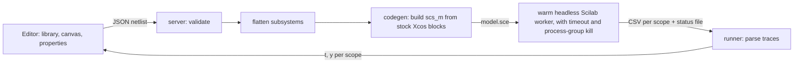
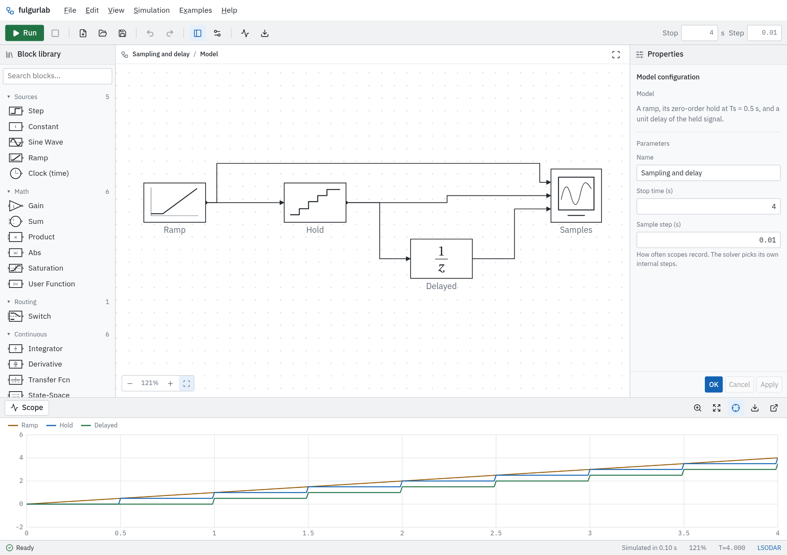
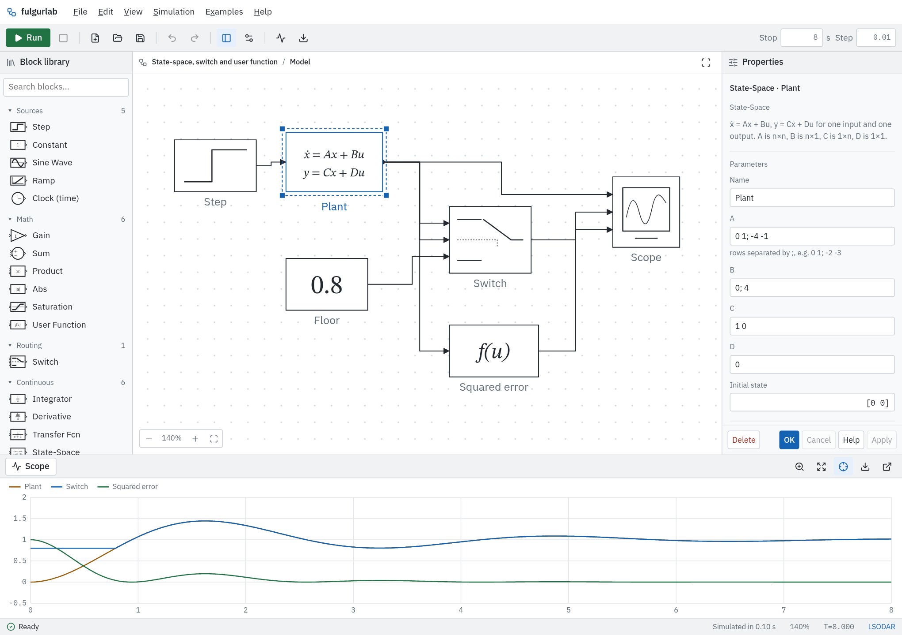

# fulgurlab

A Simulink-style block-diagram simulator for the browser, built for [scope.io](https://github.com/PontshoMbizo/scope-io). Draw a diagram and press **Run**. A small server turns the diagram into an Xcos model and simulates it with headless Scilab, then the editor plots every Scope block. There is no simulation code in the browser, so Scilab's solvers are the only engine and the results can be used to grade answers.

**Try it:** [lab.pontsho-mbizo.co.za](https://lab.pontsho-mbizo.co.za) · **Learn it:** [How to use fulgurlab](docs/how-to-use.md), a visual guide with worked examples

<p align="center"></p>

*A gain of 4 and a PID controller, each around 1/(s² + 2s + 1) with unity feedback. The gain-only loop settles at 0.8; the integral term takes the PID loop to 1. [Build it yourself](docs/how-to-use.md#p-control-against-pid-control).*

## What you can do

- Drag blocks from a searchable library, wire them, and edit their parameters.
- Group blocks into [subsystems](docs/how-to-use.md#subsystems), nested up to 4 deep.
- Plot several scopes, read values with a cursor, zoom, pop the scope out and export CSV.
- Undo and redo, multi-select, duplicate, and save or open models as JSON.
- Start from six built-in examples. The editor autosaves and follows the system's light or dark theme.

## How it works



1. The editor (`web/`, React and Vite) holds the diagram as a netlist: blocks with parameters, wires, a stop time and a scope sample step.
2. `POST /api/simulate` sends it to the server, which checks it against the block catalogue in `shared/catalog.js` and flattens any subsystems.
3. `server/src/codegen.js` writes a Scilab script that builds the Xcos diagram (`scs_m`) and calls `scicos_simulate`.
4. `server/src/runner.js` hands the script to a warm Scilab worker (`pool.js`) and returns `{ t, y[] }` for each scope.
5. The editor plots each scope.

## Design choices

| Decision | Why |
|---|---|
| Scilab/Xcos is the only engine, run on the server | Results come from established solvers (LSODAR, CVODE), not from a hand-written integrator in the browser, so they can be trusted for grading |
| A pool of warm Scilab workers | Scilab's start-up is paid once, not on every run. Variables are cleared before each job, and a worker is retired after 50 runs, or at once after a timeout or crash. `SIM_POOL=0` goes back to one process per run |
| Parameters set through each block's dialog values (`graphics.exprs`) | Scilab then computes the block's internals exactly as Xcos would when you edit a dialog |
| Nothing typed by the user reaches the script as written | Scilab evaluates block parameters as code and can run shell commands. Numbers are re-formatted, signs come from a whitelist, User Function expressions are parsed and re-emitted from the parse tree, and ids and names never appear in the script. Tests check this |
| Hardened container as a second layer | Read-only filesystem, non-root, all capabilities dropped, pid, memory and CPU limits, a 20 s timeout per run |
| JSON netlist as the wire format, not `.xcos` files | Saving script-built diagrams as `.xcos` segfaults Scilab 2024.0 |

<p align="center">


</p>

*Left: a ramp, its zero-order hold at 0.5 s, and a unit delay of the held signal. Right: a state-space plant, a switch that holds its output at 0.8 or above, and a user function for the squared error.*

## Findings

Measured on 25 November 2026 at commit `c3ce101a`. Tests ran in GitHub Actions; timings and values come from the live server (Scilab 2024.0, 2 concurrent runs).

| Area | Result |
|---|---|
| Tests | 30 tests pass in about 1.6 s: 22 for validation and code generation, 8 that run real Scilab |
| Block coverage | All 22 simulating block types run in Scilab in the tests and are checked against expected values, for example the transfer function 2/(s + 2) within 1e-3 of 1 − e^(−3) at t = 1.5 s |
| Accuracy | First-order step response: largest error 1.25e-4 against 1 − e^(−t) over 501 samples. A mass-spring-damper built from integrators peaks at 0.3610, against 0.3611 in theory |
| Subsystems | The nested PID example gives the same two traces as the flat one |
| Run time, small diagrams | Median 65 to 110 ms of server time for the six examples (five runs each), network excluded |
| Run time, long runs | 10,001 samples in about 0.1 s of server time. The download then dominates on a slow connection |
| Errors | An algebraic loop comes back as a readable error, not a crash or a hang |

## Blocks

| Category | Blocks |
|---|---|
| Sources | Step, Constant, Sine Wave, Ramp, Clock (time) |
| Math | Gain, Sum, Product, Abs, Saturation, User Function |
| Routing | Switch |
| Continuous | Integrator, Derivative, Transfer Fcn, State-Space, PID Controller, Transport Delay |
| Discrete | Zero-Order Hold, Unit Delay, Discrete TF |
| Subsystems | Subsystem, Inport, Outport |
| Sinks | Scope (1 to 8 inputs) |

The [guide](docs/how-to-use.md#block-reference) lists their parameters, [docs/blocks.md](docs/blocks.md) shows how each one maps onto stock Xcos blocks, and [CONTRIBUTING.md](CONTRIBUTING.md) explains how to add one.

## Run it

For development, one script starts the API and the editor. It uses a local Scilab if there is one, and otherwise builds and runs the server with Podman or Docker. It needs Node 20 or later, and Ctrl+C stops everything:

```bash
./run.sh   # prints the editor's address, usually http://localhost:5173
```

Everything in one container, with no local Scilab needed:

```bash
docker compose up --build   # http://localhost:8080
```

To run the parts by hand you need Node 20 or later and Scilab with the Xcos simulation library. On Ubuntu or Debian:

```bash
sudo apt install --no-install-recommends scilab-cli scilab-full-bin
npm --prefix web install
npm run dev:server    # API on :8080
npm run dev:web       # editor on http://localhost:5173 (FULGUR_WEB_PORT to change), proxies /api to 127.0.0.1:8080
npm test              # simulation tests are skipped if Scilab is not installed
```

Fedora no longer packages Scilab. There, build and run the server image with Podman and run the editor on the host:

```bash
podman build --format docker -t fulgurlab .
podman run --rm -p 8080:8080 --read-only --tmpfs /tmp --tmpfs /home/fulgur \
  --cap-drop=ALL --security-opt no-new-privileges --pids-limit 256 --memory 2g fulgurlab
npm run dev:web
podman run --rm fulgurlab sh -c "cd server && node --test test/*.test.js"
```

## Deployment

A push to `scilab-sim` runs CI. When it passes, the deploy workflow runs [`deploy.sh`](deploy.sh) on the VM, which pulls the branch, rebuilds the image, restarts it and checks `/api/health`. nginx serves it at [lab.pontsho-mbizo.co.za](https://lab.pontsho-mbizo.co.za).

## Using it in scope.io

- **iframe:** load `/?embed=1`, send it a diagram and listen for results with `postMessage`.
- **React component:** `import { FulgurEditor } from 'web/src'`.
- **HTTP only:** `POST /api/simulate` with a netlist and grade the traces on your side.

[docs/embedding.md](docs/embedding.md) covers all three.

## Limits

- There is no per-client rate limiting in the server and no network namespace for the Scilab process yet. Put the server behind an API gateway, or add both, before relying on it publicly.
- Limits per run: 200 blocks, 400 wires, 1 million samples per scope, 2 million in total, and 20 s.
- It is pinned to Scilab 2024.0 from Ubuntu. Upstream is newer, and the tests are the regression check before any upgrade.
- The State-Space block is single-input single-output, and the User Function has no time variable.
- The editor's autosave holds one diagram, in the browser only.
- The repository started as a fork of CircuitJS. That code was removed in November 2026 and only remains in the git history.

## Layout

| Path | Holds |
|---|---|
| `shared/catalog.js` | Block catalogue (ports, parameters, limits), used by the editor and the server |
| `server/src/` | `netlist.js` validation, `codegen.js` Scilab script generation, `runner.js` sandboxed runner, `server.js` HTTP API |
| `server/test/` | Validation tests and real-Scilab tests against analytic answers |
| `web/` | React and Vite editor: canvas, palette, inspector, scope charts |
| `examples/` | Sample diagrams, used by the tests and the Examples menu |
| `docs/` | [User guide](docs/how-to-use.md), architecture and Scilab quirks, netlist format and API, block mapping, embedding |
| `run.sh`, `deploy.sh` | Start everything for development; redeploy on the VM |

## Licence

GPL-2.0. See [COPYING.txt](COPYING.txt).
