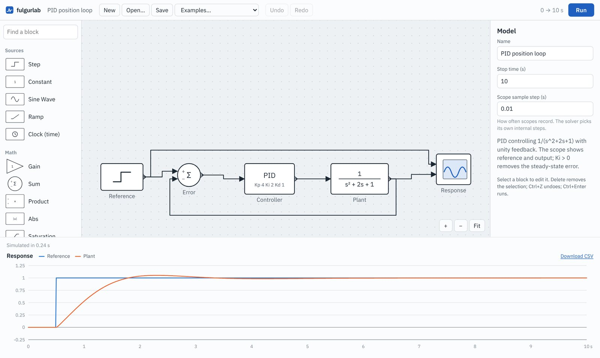
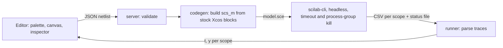
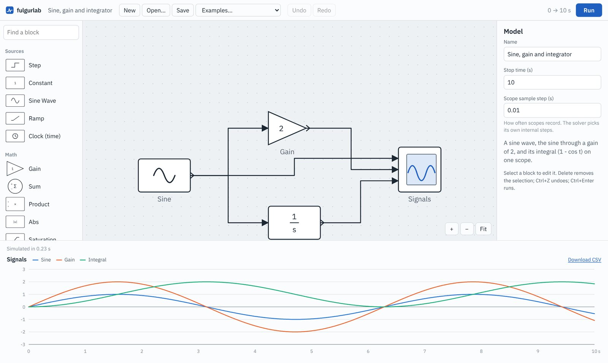
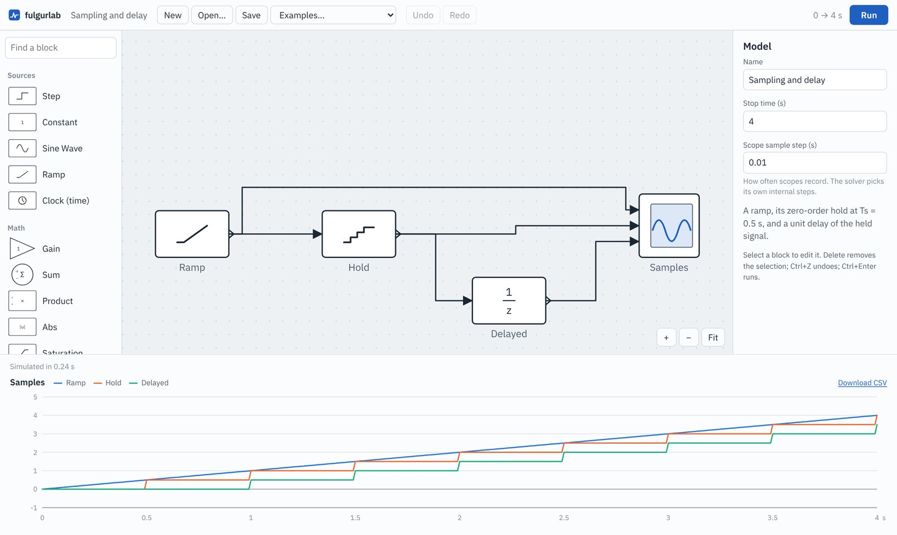

# fulgurlab

A Simulink-style block-diagram simulator for the browser, built for [scope.io](https://github.com/PontshoMbizo/scope-io). Draw a diagram and press **Run**. A small server turns the diagram into an Xcos model and simulates it with headless Scilab, then the editor plots every Scope block. There is no simulation code in the browser, so Scilab's solvers are the only engine and the results can be used to grade answers.

<p align="center"></p>

*The PID example: a step reference, a PID controller around 1/(s² + 2s + 1) with unity feedback, and the response plotted after a 0.24 s run.*

## How it works



1. The editor (`web/`, React and Vite) holds the diagram as a netlist: blocks with numeric parameters, wires, a stop time and a scope sample step.
2. `POST /api/simulate` sends it to the server, which checks it against the block catalogue in `shared/catalog.js`.
3. `server/src/codegen.js` writes a Scilab script that builds the Xcos diagram (`scs_m`) and calls `scicos_simulate`.
4. `server/src/runner.js` runs Scilab in a fresh temp directory and returns `{ t, y[] }` for each scope.
5. The editor plots each scope, with a crosshair readout and CSV export.

## Design choices

| Decision | Why |
|---|---|
| Scilab/Xcos is the only engine, run on the server | Results come from established solvers (LSODAR, CVODE), not from a hand-written integrator in the browser, so they can be trusted for grading |
| One fresh `scilab-cli` process per run | Simple and isolated: a crash or hang can only affect its own run. The cost is about 0.2 s of start-up per run |
| Parameters set through each block's dialog values (`graphics.exprs`) | Scilab then computes the block's internals exactly as Xcos would when you edit a dialog |
| Nothing typed by the user reaches the script | Scilab evaluates block parameters as code and can run shell commands. Parameters must be numbers, signs come from a whitelist, ids and names never appear in the script, and a test checks this |
| Hardened container as a second layer | Read-only filesystem, non-root, all capabilities dropped, pid, memory and CPU limits, a 20 s timeout per run |
| JSON netlist as the wire format, not `.xcos` files | Saving script-built diagrams as `.xcos` segfaults Scilab 2024.0 |

<p align="center">


</p>

*Left: a sine, the sine through a gain of 2, and its integral 1 − cos t. Right: a ramp, its zero-order hold at 0.5 s, and a unit delay of the held signal.*

## Findings

Measured on 6 November 2026 with Scilab 2024.0 (Ubuntu 24.04 package) and Node 22, one simulation at a time.

| Area | Result |
|---|---|
| Tests | 16 tests pass in about 6 s: 12 for validation and code generation, 4 that run real Scilab and compare against analytic answers |
| Block coverage | All 19 block types simulate and match their analytic values, for example the transfer function 2/(s + 2) within 1e-3 of 1 − e^(−3) at t = 1.5 s |
| Accuracy | First-order step response: largest error 1.25e-4 against 1 − e^(−t) over 501 samples |
| Run time, small diagrams | 0.22 to 0.24 s median per run for the four examples (five runs each, end to end over HTTP), almost all of it Scilab start-up |
| Run time, long runs | 10,001 samples in 0.24 s, 100,001 in 0.53 s, about 1 million (the per-scope limit) in 3.5 s |
| Errors | An algebraic loop comes back as a readable error, not a crash or a hang |

## Blocks

| Category | Blocks |
|---|---|
| Sources | Step, Constant, Sine Wave, Ramp, Clock (time) |
| Math | Gain, Sum, Product, Abs, Saturation |
| Continuous | Integrator, Derivative, Transfer Fcn, PID Controller, Transport Delay |
| Discrete | Zero-Order Hold, Unit Delay, Discrete TF |
| Sinks | Scope (1 to 8 inputs) |

[docs/blocks.md](docs/blocks.md) shows how each one maps onto stock Xcos blocks. [CONTRIBUTING.md](CONTRIBUTING.md) explains how to add one.

## Run it

Everything in one container, with no local Scilab needed:

```bash
docker compose up --build   # http://localhost:8080
```

For development you need Node 20 or later and Scilab with the Xcos simulation library. On Ubuntu or Debian:

```bash
sudo apt install --no-install-recommends scilab-cli scilab-full-bin
npm --prefix web install
npm run dev:server    # API on :8080
npm run dev:web       # editor on http://localhost:5173, proxies /api to :8080
npm test              # simulation tests are skipped if Scilab is not installed
```

Fedora no longer packages Scilab. There, build and run the server image with Podman and run the editor on the host:

```bash
podman build --format docker -t fulgurlab .
podman run --rm -p 8080:8080 --read-only --tmpfs /tmp --tmpfs /home/fulgur \
  --cap-drop=ALL --security-opt no-new-privileges --pids-limit 256 --memory 2g fulgurlab
npm run dev:web
podman run --rm fulgurlab sh -c "cd server && node --test test/*.test.js"
```

## Using it in scope.io

- **iframe:** load `/?embed=1`, send it a diagram and listen for results with `postMessage`.
- **React component:** `import { FulgurEditor } from 'web/src'`.
- **HTTP only:** `POST /api/simulate` with a netlist and grade the traces on your side.

[docs/embedding.md](docs/embedding.md) covers all three.

## Limits

- Each run starts a new Scilab process, so even a tiny diagram takes about 0.2 s. A warm pool of Scilab processes would remove most of that and has not been built.
- There is no per-client rate limiting and no network namespace for the Scilab process yet. Put the server behind scope.io's API gateway, or add both, before exposing it publicly.
- Limits per run: 200 blocks, 1 million samples per scope, 2 million in total.
- It is pinned to Scilab 2024.0 from Ubuntu. Upstream is newer, and the tests are the regression check before any upgrade.
- 19 blocks so far. There are no state-space, switch or user-function blocks and no subsystems.
- The repository started as a fork of CircuitJS. That code was removed in November 2026 and only remains in the git history.

## Layout

| Path | Holds |
|---|---|
| `shared/catalog.js` | Block catalogue (ports, parameters, limits), used by the editor and the server |
| `server/src/` | `netlist.js` validation, `codegen.js` Scilab script generation, `runner.js` sandboxed runner, `server.js` HTTP API |
| `server/test/` | Validation tests and real-Scilab tests against analytic answers |
| `web/` | React and Vite editor: canvas, palette, inspector, scope charts |
| `examples/` | Sample diagrams, used by the tests and the Examples menu |
| `docs/` | Architecture and Scilab quirks, netlist format and API, block mapping, embedding |

## Licence

GPL-2.0. See [COPYING.txt](COPYING.txt).
