# How to use fulgurlab

fulgurlab is a block-diagram simulator that runs in the browser. You drag blocks onto a canvas, wire them together and press **Run**. The server simulates the diagram with Scilab/Xcos, and the editor plots what each **Scope** recorded.

Open it at **[lab.pontsho-mbizo.co.za](https://lab.pontsho-mbizo.co.za)**, or [run it yourself](../README.md#run-it). There is nothing to sign in to.

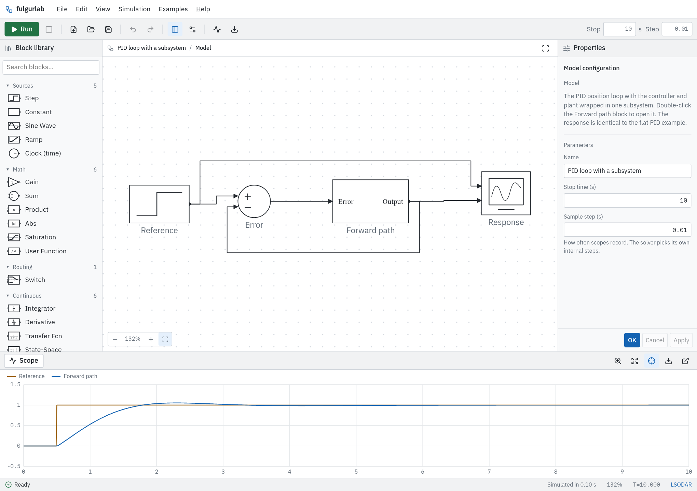

*What you see on a first visit: an example PID loop, here after pressing Run.*

## Contents

1. [The screen](#the-screen)
2. [Your first model](#your-first-model)
3. [Working on the canvas](#working-on-the-canvas)
4. [Parameters and model settings](#parameters-and-model-settings)
5. [Reading the scope](#reading-the-scope)
6. [Worked examples](#worked-examples)
7. [Subsystems](#subsystems)
8. [Saving and opening models](#saving-and-opening-models)
9. [When something goes wrong](#when-something-goes-wrong)
10. [Block reference](#block-reference)
11. [Keyboard shortcuts](#keyboard-shortcuts)
12. [Limits](#limits)

## The screen

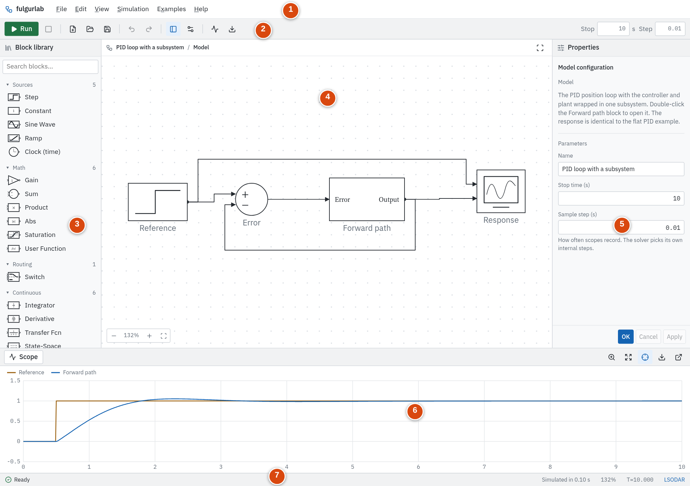

| # | Area | What it is for |
|---|---|---|
| 1 | Menu bar | File, Edit, View, Simulation, Examples and Help |
| 2 | Toolbar | Run and Stop, new/open/save, undo/redo, show the library, model settings, scope, CSV export, and the **Stop** time and sample **Step** |
| 3 | Block library | Every block, grouped by category, with a search box |
| 4 | Canvas | Your diagram. The path above it shows where you are when inside a subsystem |
| 5 | Properties | Settings of the selected block, or of the whole model when nothing is selected |
| 6 | Scope | Plots after a run, or the list of problems if the run failed |
| 7 | Status bar | Messages, run time, zoom, stop time and solver |

### The block library

<table>
<tr>
<td valign="top">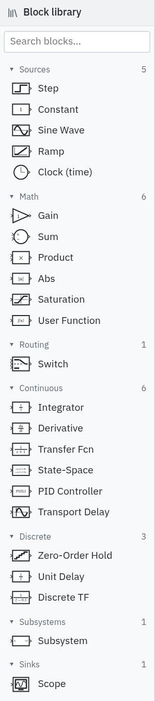</td>
<td valign="top">

**To add a block**, either:

- drag it from the library onto the canvas, or
- click it, and it lands in the middle of the visible canvas.

**Discrete** and **Sinks** start folded. Click a category name to open or close it. The **Scope** block is under **Sinks**.

Hover over a block to read what it does.

To find a block quickly, type in the search box. It matches names, descriptions and categories:

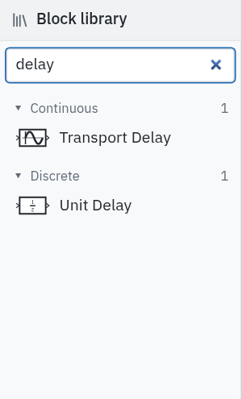

**Inport** and **Outport** only appear while you are inside a subsystem.

</td>
</tr>
</table>

## Your first model

You will send a unit step into the system 1/(s + 1) and plot the response. The exact answer is y(t) = 1 − e^(−t), so you can check the result.

### Step 1: start an empty model

Choose **File → New**.

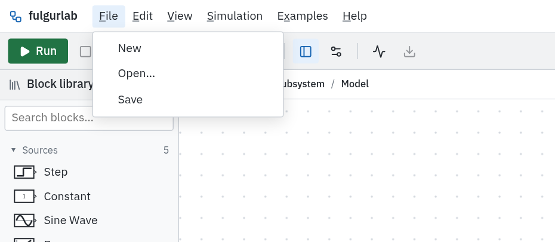

> **New**, **Open** and the **Examples** menu replace the current diagram without asking. [Save](#saving-and-opening-models) first if you want to keep it.

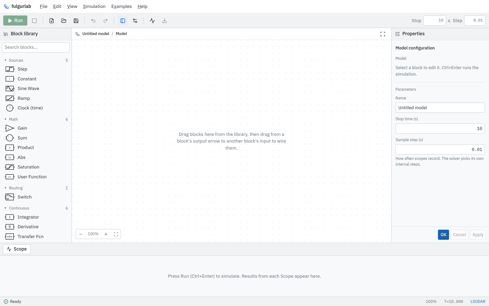

### Step 2: add three blocks

Add these and drag them into a row:

| Block | Category |
|---|---|
| Step | Sources |
| Transfer Fcn | Continuous |
| Scope | Sinks |

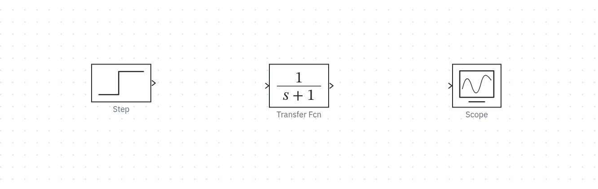

### Step 3: wire them

Press on the **output arrow** on the right of Step, drag to the input of Transfer Fcn, and release. A dashed line follows the pointer and snaps to a nearby input.

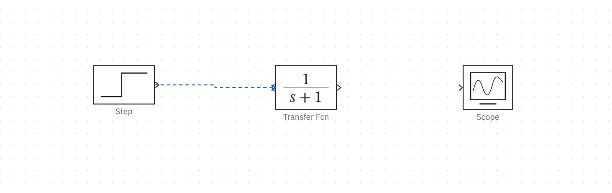

Then wire Transfer Fcn to Scope in the same way.

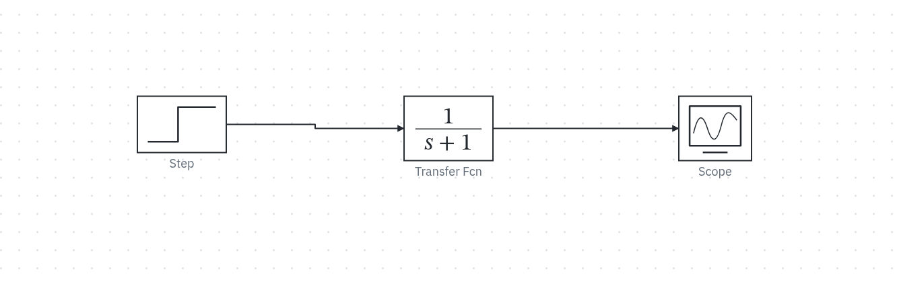

### Step 4: set the parameters

Click **Step**. In **Properties**, set **Step time (s)** to `0`, then press **Enter**.

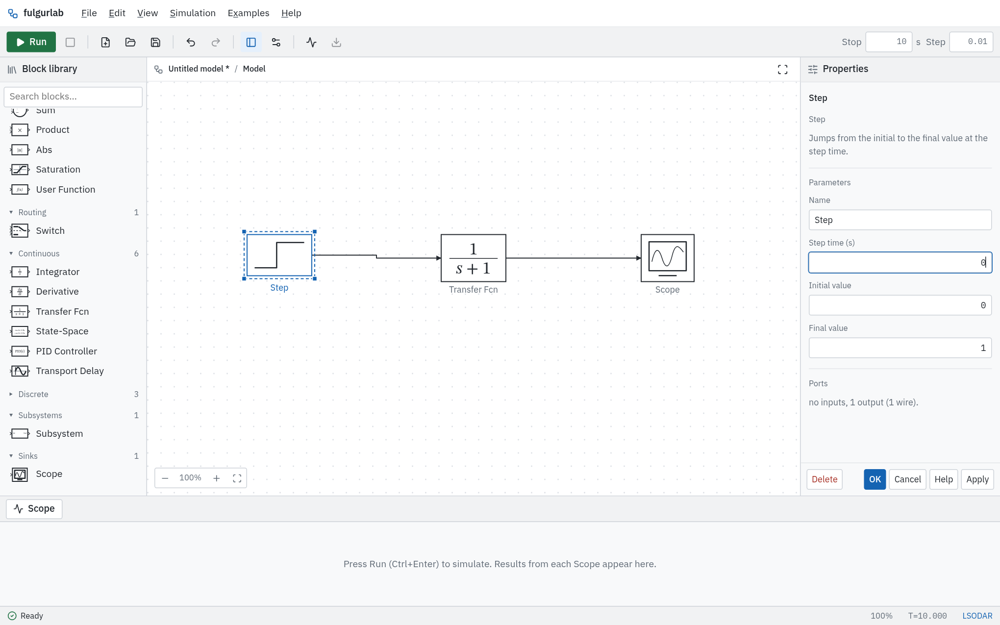

Click **Transfer Fcn**. Its default denominator `[1 1]` already means s + 1. Change **Name** to `Plant` and click **Apply**. The scope will label the trace with this name.

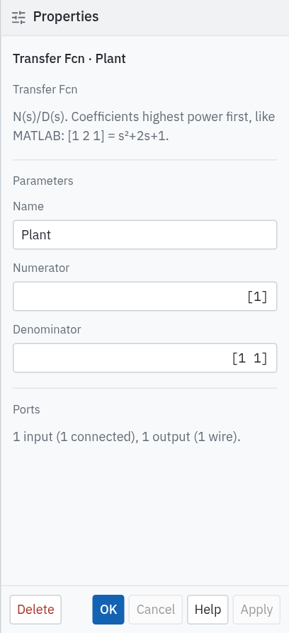

> Edits take effect when you press **Enter**, **OK** or **Apply**. If you select something else first, the edit is dropped.

### Step 5: set the model

Click an empty part of the canvas (or press **Escape**). Properties now shows the model. Set **Name** to `My first model` and **Stop time** to `5`, then click **Apply**.

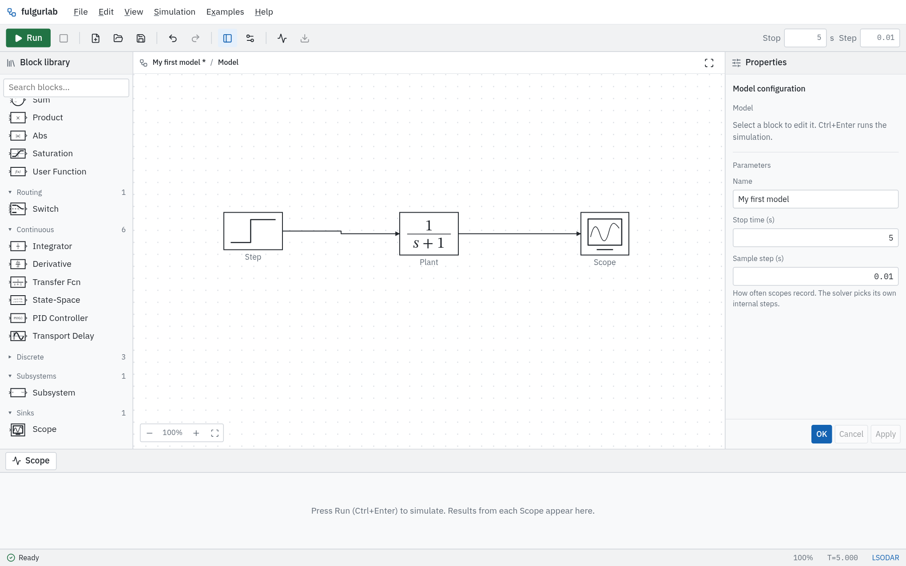

### Step 6: run

Press **Run** or **Ctrl+Enter**.

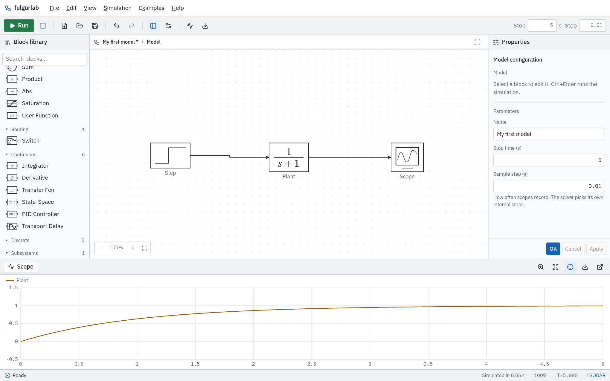

Move the pointer over the plot to read values. At t = 1 s the trace reads **0.632**, which is 1 − e^(−1).

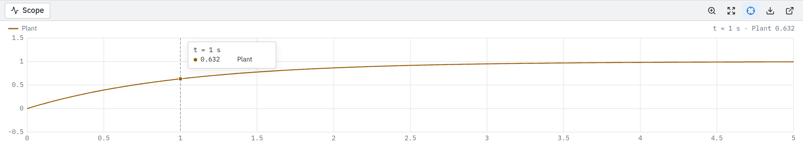

If you change the diagram or its settings, the old plot stays on screen and the status bar tells you it is out of date. Run again to update it. Moving blocks around doesn't count as a change.

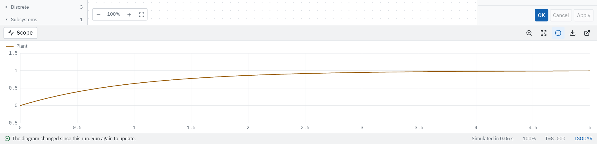

## Working on the canvas

| To | Do this |
|---|---|
| Select a block or wire | Click it |
| Select several blocks | Shift+click (or Ctrl+click) each one, or drag a box around them |
| Move blocks | Drag any selected block. Blocks snap to a grid |
| Wire two blocks | Drag from an output to an input |
| Branch a signal | Drag again from the same output. A dot marks the branch |
| Replace a wire | Drag a new wire onto the occupied input |
| Delete | Select, then press **Delete** or **Backspace** |
| Copy blocks | **Ctrl+D** copies the selection, including the wires between the copied blocks |
| Undo / redo | **Ctrl+Z** / **Ctrl+Y** (up to 100 steps) |
| Zoom | Mouse wheel, or the − and + buttons at the lower left |
| Pan | Middle-drag, or Alt+drag |
| See the whole diagram | The **Fit** button, at the lower left or above the canvas |

Rules for wires:

- Wires start at an output and end at an input.
- Each input takes exactly one wire. An output can feed many inputs.
- Every input must be wired before the model will run.
- A block can't be wired straight to itself. Feedback goes through another block, such as a Sum.

> **Tip:** the scope panel takes some canvas height when it first appears. Press **Fit** if the bottom of your diagram disappears behind it.

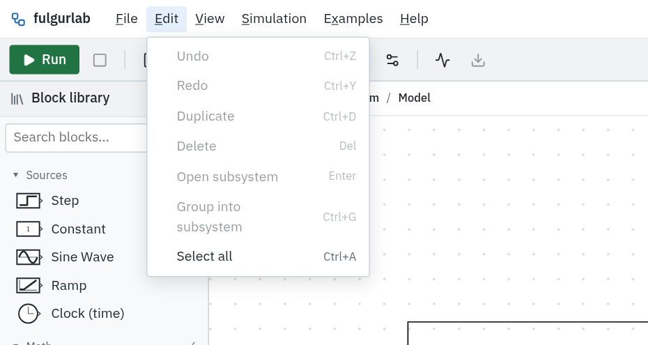

## Parameters and model settings

### Typing values

| Kind | How to write it | Example |
|---|---|---|
| Number | Plain or scientific notation | `2.5`, `1e-3` |
| Polynomial | Coefficients, **highest power first**, separated by spaces or commas | `[1 2 1]` means s² + 2s + 1 |
| Matrix | Rows separated by `;` | `0 1; -4 -1` |
| Sum signs | One `+` or `-` per input, 1 to 8 | `+--` gives three inputs |
| Product operations | One `*` or `/` per input, 1 to 8 | `*/` divides input 1 by input 2 |
| Expression | See [User Function](#a-nonlinear-pendulum-with-a-user-function) | `-9.81*sin(u1) - 0.5*u2` |

Fields take numbers only: write `0.5`, not `1/2` or `pi`. A field that can't be read turns red and says what it expects. Changing the number of inputs removes any wires to ports that no longer exist.

### Model settings

| Setting | Meaning | Default for a new model |
|---|---|---|
| Name | Shown above the canvas, and used for the saved file name | Untitled model |
| Stop time (s) | How long to simulate, up to 10000 | 10 |
| Sample step (s) | How often scopes record a point | 0.01 |

The sample step only controls what is **recorded**. The solver chooses its own internal steps, so a larger sample step gives a coarser plot, not a less accurate solution. Stop time and step can also be edited at the right of the toolbar.

## Reading the scope

Each input of a Scope becomes one trace, named after the block that feeds it. To compare signals, give a Scope more inputs: select it and raise **Number of inputs** (up to 8). With two or more Scope blocks, the panel shows one tab for each.

The buttons at the top right of the panel, from left to right:

| Button | Does |
|---|---|
| Zoom | Turn it on, then drag across a time range |
| Autoscale | Go back to the full time range |
| Cursor | Show or hide the value readout under the pointer |
| Export CSV | Download this scope as a CSV file: time, then one column per trace |
| Pop out | Move the scope into a window you can drag |

**Zooming in.** Turn on **Zoom** and drag across the times you want:

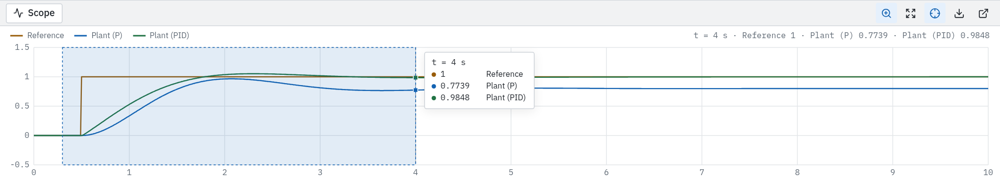

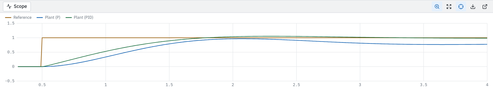

**Popping out.** Drag the window by its title bar. Close it, or press **Escape** while it has focus, to dock it again.

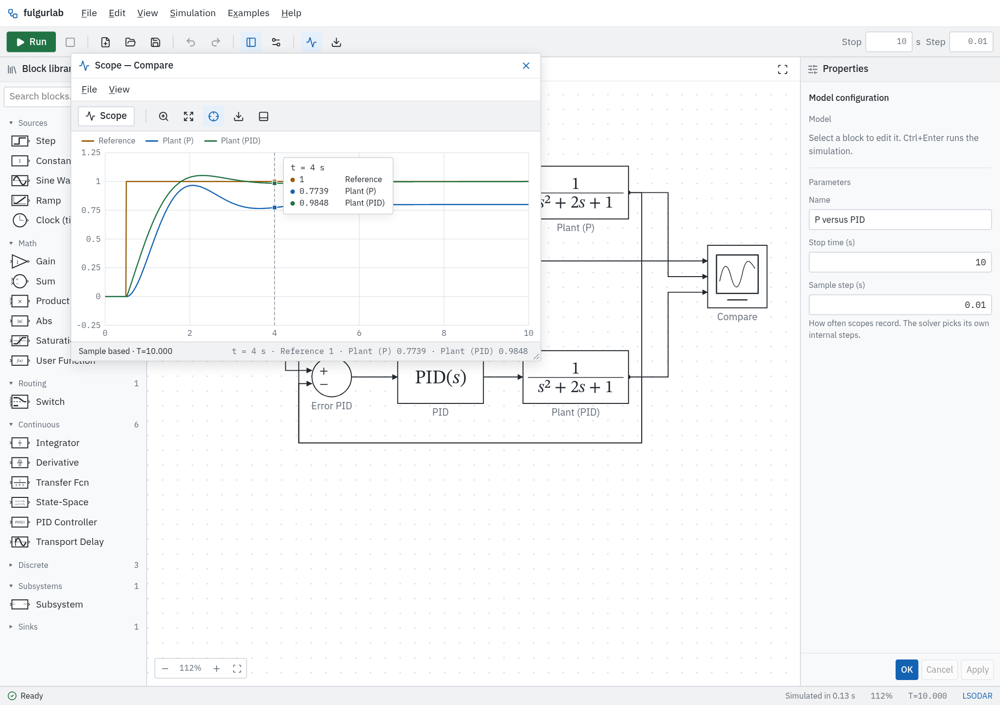

The **Export CSV** button on the main toolbar downloads every scope, one file each.

## Worked examples

The **Examples** menu holds ready-made models. Three of the walkthroughs below use them, and three you build yourself.

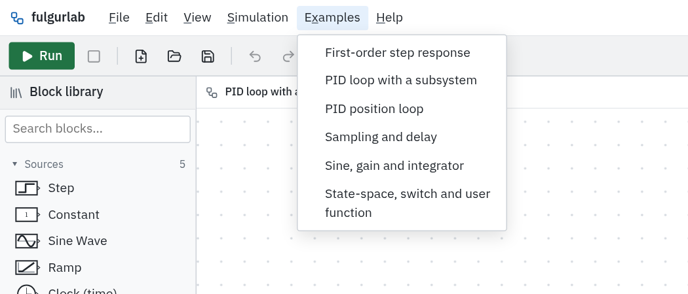

### P control against PID control

**Question:** how much does the integral term matter? Control the plant 1/(s² + 2s + 1) twice, once with a gain only and once with a PID controller, and plot both.

| Name | Block | Settings |
|---|---|---|
| Reference | Step | Step time `0.5` |
| Error P, Error PID | Sum (two of them) | Signs `+-` |
| Kp only | Gain | K `4` |
| PID | PID Controller | Kp `4`, Ki `2`, Kd `1`, Filter N `100` |
| Plant (P), Plant (PID) | Transfer Fcn (two of them) | Numerator `[1]`, Denominator `[1 2 1]` |
| Compare | Scope | Number of inputs `3` |

Wiring (the model keeps the default stop time of 10 s):

- Reference → **+** of both Sums, and → Compare input 1
- Error P → Kp only → Plant (P) → Compare input 2
- Error PID → PID → Plant (PID) → Compare input 3
- Each plant's output → the **−** input of its own Sum

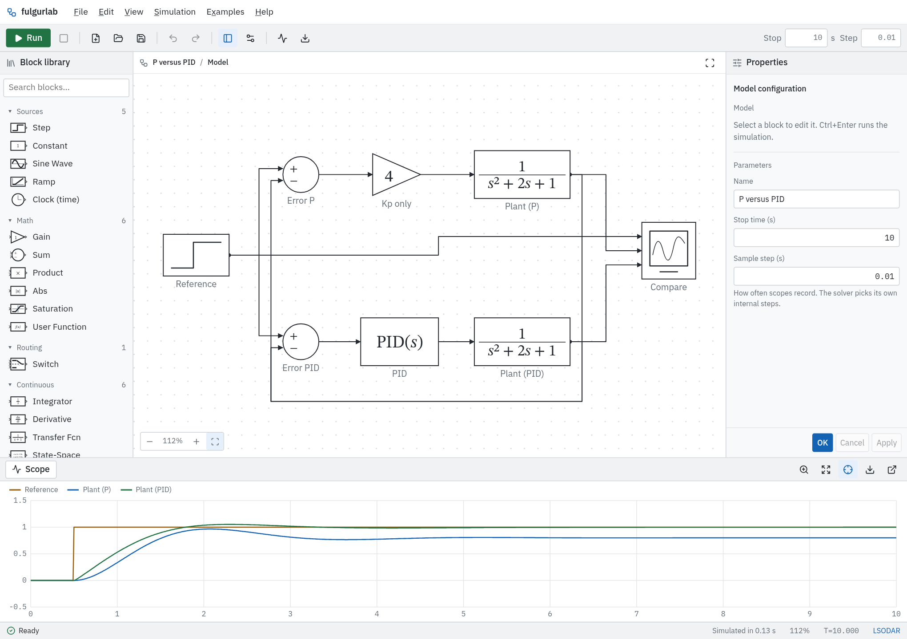

| | Value at t = 10 s | Highest value |
|---|---|---|
| Gain only | 0.800 | 0.966 |
| PID | 1.000 | 1.052 |

The gain-only loop settles at Kp / (1 + Kp) = 4/5, short of the target. The integral term removes that error, at the cost of a small overshoot. Now try changing **Ki** and running again.

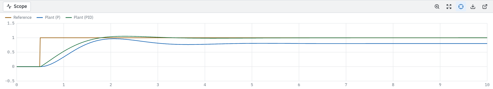

### A mass on a spring, from integrators

**Question:** how do you simulate a differential equation? Take a mass m on a spring k with damper c, pushed by a force F:

m·x″ + c·x′ + k·x = F, with m = 1, c = 1, k = 4

Solve for the highest derivative, x″ = F − c·x′ − k·x. A Sum builds the right-hand side, and two integrators turn x″ into x′ and then x.

| Name | Block | Settings |
|---|---|---|
| Force | Step | Step time `0` |
| Net force | Sum | Signs `+--` |
| Velocity | Integrator | Initial condition `0` |
| Position | Integrator | Initial condition `0` |
| Damping c | Gain | K `1` |
| Spring k | Gain | K `4` |
| Motion | Scope | Number of inputs `2` |

Wiring:

- Force → Net force input 1
- Net force → Velocity → Position
- Velocity → Damping c → Net force input 2
- Position → Spring k → Net force input 3
- Position → Motion input 1, Velocity → Motion input 2

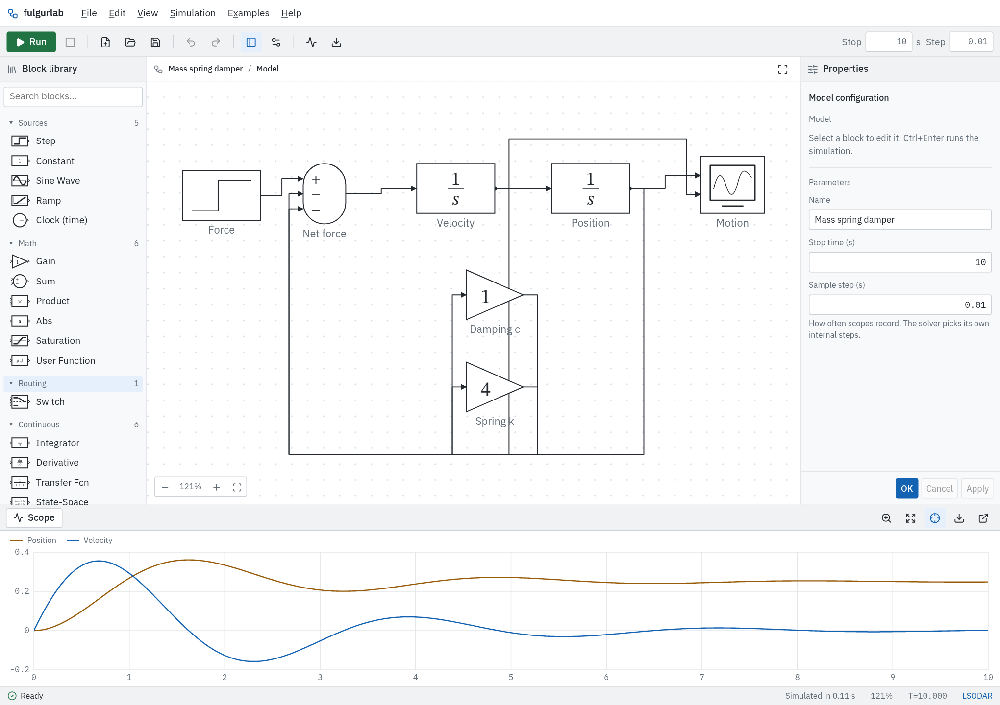

The position peaks at **0.361** at t = 1.62 s and settles towards F/k = 0.25. The textbook peak for this system is 0.361 at t = 1.622 s.

> For a mass other than 1, add a Gain of 1/m between the Sum and the first integrator.

### A nonlinear pendulum with a User Function

**Question:** what if the equation isn't linear? A damped pendulum follows θ″ = −9.81·sin θ − 0.5·θ′. The **User Function** block computes the right-hand side from an expression.

| Name | Block | Settings |
|---|---|---|
| Acceleration | User Function | Number of inputs `2`, Expression `-9.81*sin(u1) - 0.5*u2` |
| Speed | Integrator | Initial condition `0` |
| Angle | Integrator | Initial condition `2` (radians) |
| Swing | Scope | Number of inputs `2` |

Wiring:

- Acceleration → Speed → Angle
- Angle → Acceleration input 1 (`u1`)
- Speed → Acceleration input 2 (`u2`)
- Angle → Swing input 1, Speed → Swing input 2

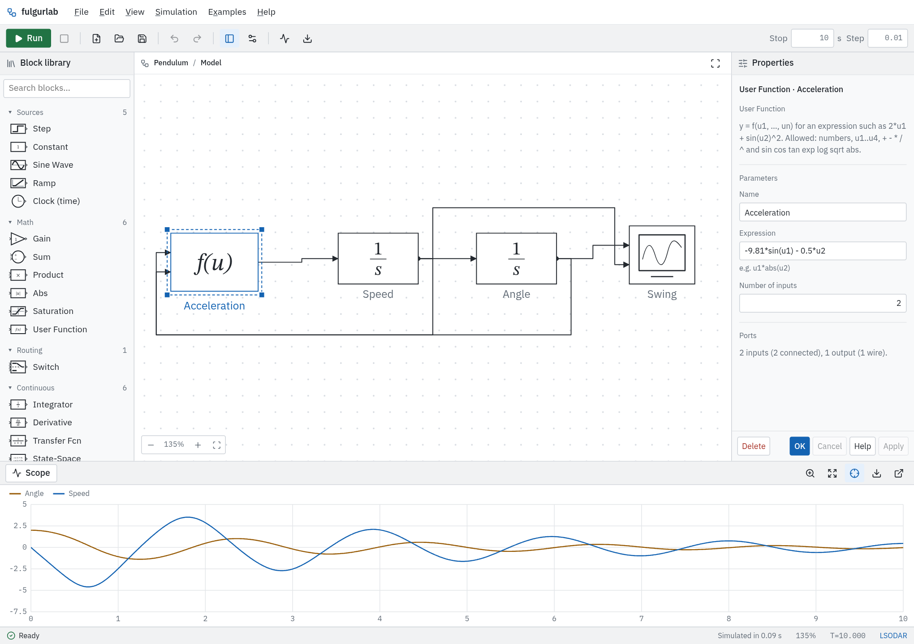

An expression may use:

- the inputs `u1` to `u4`
- numbers
- `+ - * / ^` and brackets
- `sin cos tan exp log sqrt abs`

There is no time variable. If you need t, wire a **Clock** block into one of the inputs.

### Sampling and delay

Choose **Examples → Sampling and delay** and press **Run**. A ramp passes through a **Zero-Order Hold** and then a **Unit Delay**, both with a sample time of 0.5 s.

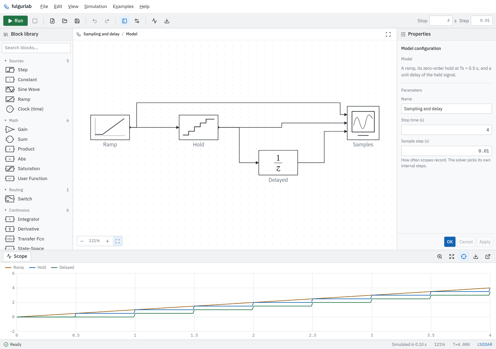

| Time | Ramp | Hold | Delayed |
|---|---|---|---|
| 1.25 s | 1.25 | 1.0 | 0.5 |
| 2.75 s | 2.75 | 2.5 | 2.0 |

The hold keeps the last sample until the next one, and the delay shows the sample before that. The sloped edges on the steps come from the recording step: lines join one recorded point to the next.

### State-space, Switch and User Function

Choose **Examples → State-space, switch and user function**. Click **Plant** to see how matrices are typed.

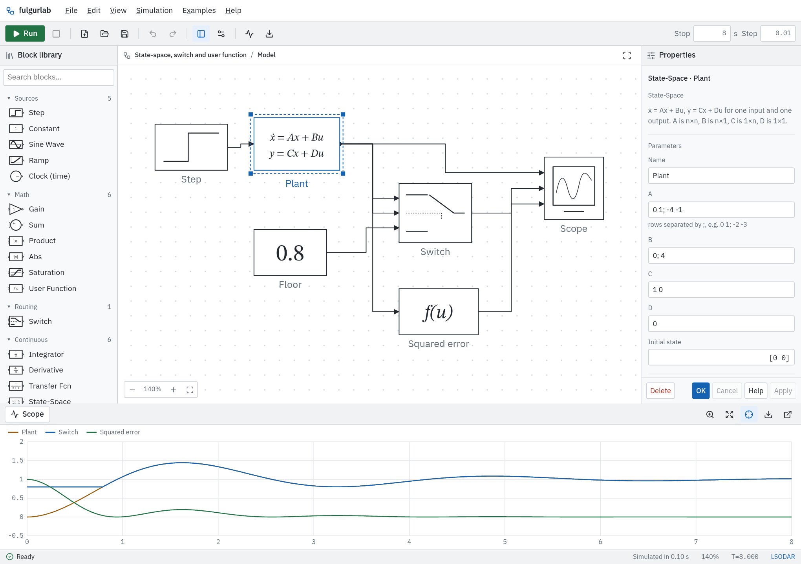

- **Plant** is a lightly damped second-order system written as ẋ = Ax + Bu, y = Cx + Du.
- **Switch** passes input 1 while the control signal (input 2) is at least 0.8, and input 3 (a constant 0.8) otherwise. The result never drops below 0.8.
- **Squared error** is the User Function `(1 - u1)^2`.

The Switch's criterion is a number: `0` means control ≥ threshold, `1` means control > threshold, `2` means control ≠ threshold.

### Sine, gain and integrator

Choose **Examples → Sine, gain and integrator**. One signal branches three ways: straight to the scope, through a gain of 2, and through an integrator, which gives 1 − cos t.

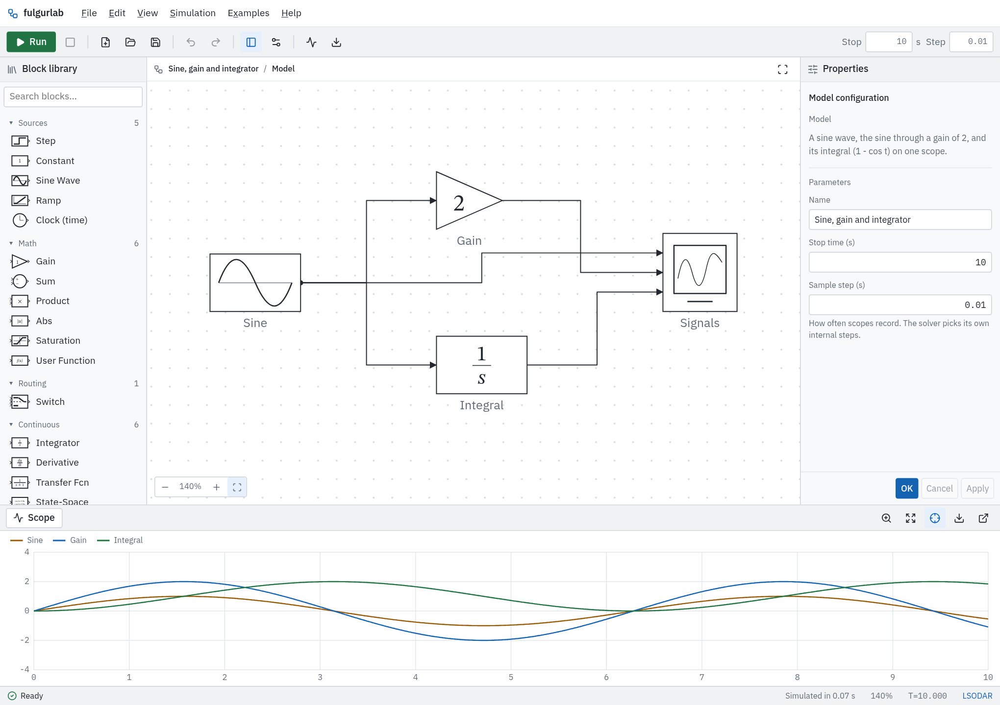

## Subsystems

A subsystem is a diagram inside a block. Use one to keep a large model readable.

### Group existing blocks

1. Choose **Examples → PID position loop**.
2. Click **Controller**, then Shift+click **Plant**.

   
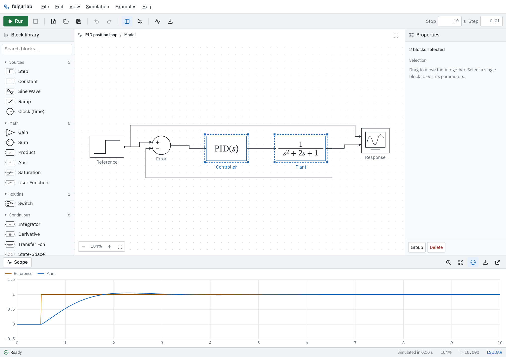

3. Press **Ctrl+G** (or **Group** in Properties). The two blocks become one, and wires that crossed the edge now go through ports. Rename it `Forward path`.

   
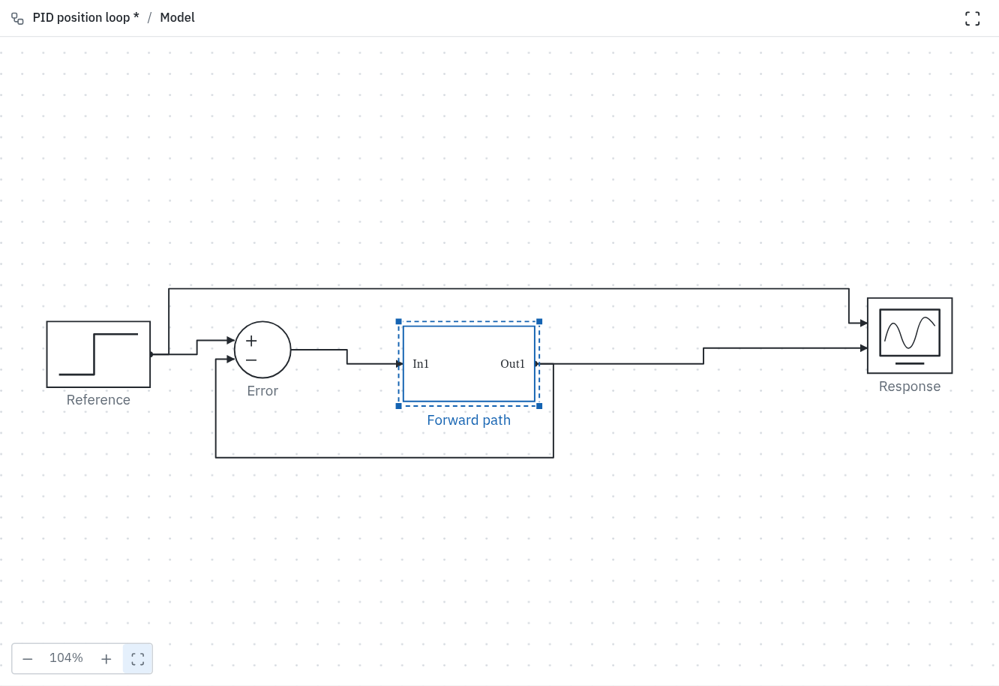

4. **Double-click** it, or select it and press **Enter**, to look inside. Click the model name in the path above the canvas, or press **Alt+Up**, to come back.

   
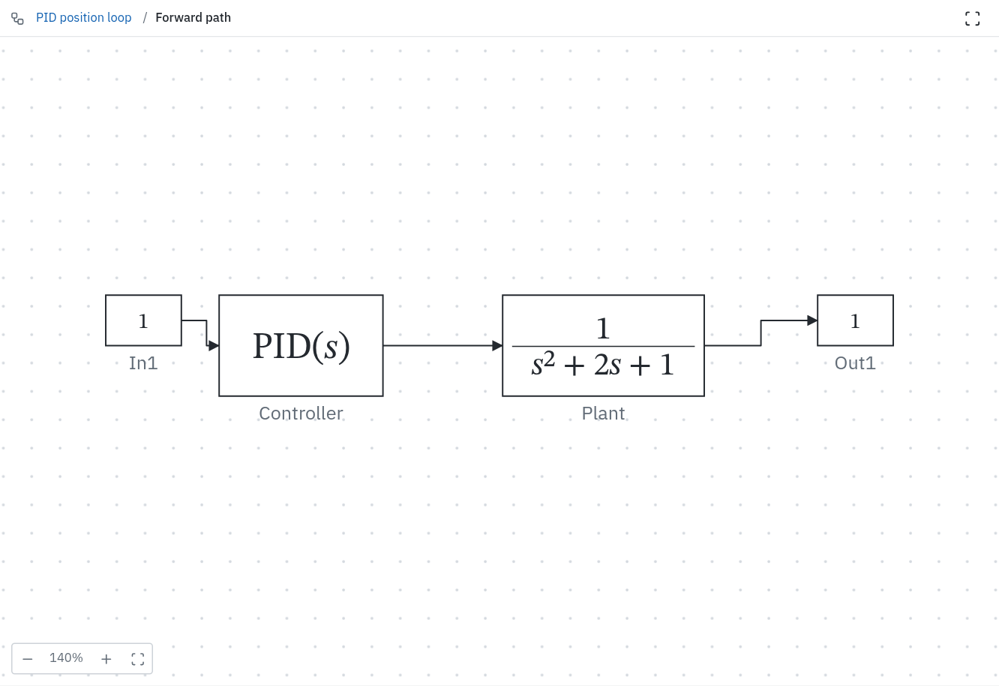

Grouping doesn't change the result. **Examples → PID loop with a subsystem** produces the same trace as **PID position loop**.

### Build one from empty

Add a **Subsystem** block from the library and open it. It starts with an Inport wired to an Outport. Put your blocks between them.

- Each **Inport** becomes an input of the subsystem, and each **Outport** an output.
- Ports are ordered by their **Port number**, which must be unique among Inports, and among Outports.
- A port's name is the label on the outside of the block.
- A Scope inside a subsystem works as usual. Its tab is titled with the path, for example *Forward path / Scope*.
- Subsystems can be nested up to 4 deep.

## Saving and opening models

| Action | How | Notes |
|---|---|---|
| Save | **File → Save** | Downloads `<model_name>.fulgur.json` |
| Open | **File → Open…** | Loads a saved file |
| Autosave | Automatic | The browser keeps the current diagram and restores it on your next visit |

An `*` after the model name means there are changes since you last saved or loaded.

Autosave holds **one** diagram, in this browser only. It is not a backup: clearing site data removes it, and loading another model replaces it. Use **Save** for anything you care about. The file is readable JSON, described in [netlist.md](netlist.md).

## When something goes wrong

The scope panel becomes a **Problems** list. Blocks with a problem turn red.

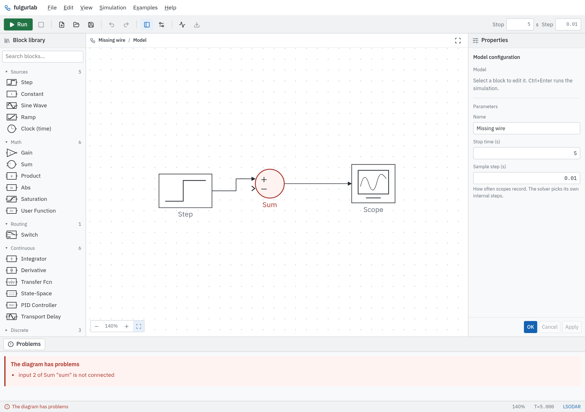

The list names blocks by their internal id (`"sum"` above). Look for the red block, or select it to read the message with its name in Properties.

An **algebraic loop** is a feedback path where each value depends on itself at the same instant:

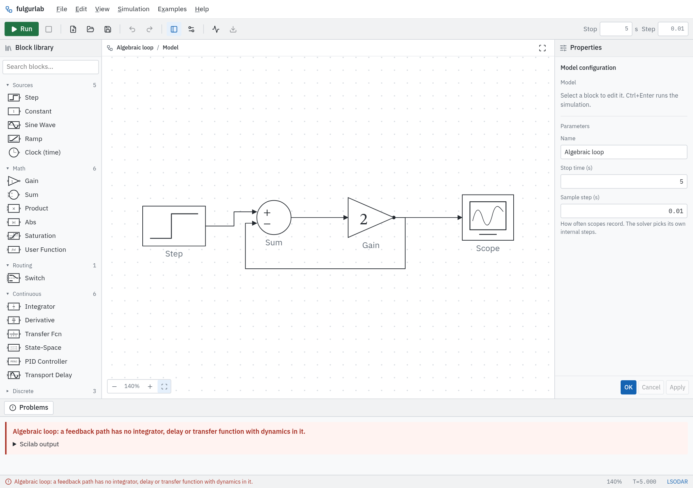

| Message | What to do |
|---|---|
| input N of … is not connected | Wire that input, or lower the block's input count |
| add a Scope so there is something to record | Add a Scope from **Sinks** and wire it |
| Algebraic loop | Put an Integrator, a Unit Delay, or a Transfer Fcn whose numerator has a lower degree than its denominator into the feedback path |
| transfer function must be proper | The numerator's degree can't exceed the denominator's |
| sample time must be positive | Set Ts above 0 |
| lower limit must not exceed upper limit | Swap the Saturation limits |
| … samples per scope, or … samples in total | Use a larger sample step or a shorter stop time |
| simulation timed out after 20 s | Shorten the stop time, or look for a signal that grows without bound or switches very fast |

When Scilab itself refuses a model, open **Scilab output** under the message for the console log.

**Stop** makes the editor stop waiting for a run.

## Block reference

| Block | Category | Parameters (default) | Output |
|---|---|---|---|
| Step | Sources | step time (1), initial (0), final (1) | Jumps from initial to final at the step time |
| Constant | Sources | value (1) | The value |
| Sine Wave | Sources | amplitude (1), frequency in rad/s (1), phase in rad (0) | A·sin(ωt + φ) |
| Ramp | Sources | slope (1), start time (0), initial (0) | Rises from the start time |
| Clock (time) | Sources | none | t |
| Gain | Math | K (1) | K·u |
| Sum | Math | signs (`+-`) | Signed sum |
| Product | Math | operations (`**`) | Product or quotient |
| Abs | Math | none | \|u\| |
| Saturation | Math | upper (1), lower (−1) | u limited to the range |
| User Function | Math | expression (`u1`), inputs (1, up to 4) | The expression |
| Switch | Routing | criterion (0), threshold (0) | Input 1 or input 3, chosen by input 2 |
| Integrator | Continuous | initial condition (0) | ∫u dt |
| Derivative | Continuous | none | du/dt, numerical |
| Transfer Fcn | Continuous | numerator (`[1]`), denominator (`[1 1]`) | N(s)/D(s) |
| State-Space | Continuous | A, B, C, D, initial state | One input, one output, up to 16 states |
| PID Controller | Continuous | Kp (1), Ki (0), Kd (0), N (100) | Kp + Ki/s + Kd·N·s/(s + N) |
| Transport Delay | Continuous | delay T (1), initial output (0) | u(t − T) |
| Zero-Order Hold | Discrete | sample time (0.1) | Samples and holds |
| Unit Delay | Discrete | sample time (0.1), initial value (0) | Previous sample |
| Discrete TF | Discrete | numerator (`[1]`), denominator (`[1 -0.5]`), sample time (0.1) | N(z)/D(z) |
| Subsystem | Subsystems | none | The diagram inside it |
| Inport, Outport | Subsystems | port number (1) | A port of the enclosing subsystem |
| Scope | Sinks | inputs (1, up to 8) | Records and plots |

[blocks.md](blocks.md) shows the Xcos block behind each one.

## Keyboard shortcuts

Also under **Help → Keyboard shortcuts**. On a Mac, use Cmd in place of Ctrl.

| Keys | Action |
|---|---|
| Ctrl+Enter | Run |
| Ctrl+Z | Undo |
| Ctrl+Y or Ctrl+Shift+Z | Redo |
| Ctrl+D | Duplicate the selection |
| Ctrl+G | Group the selection into a subsystem |
| Ctrl+A | Select all blocks |
| Enter | Open the selected subsystem |
| Alt+Up | Go to the parent diagram |
| Delete or Backspace | Delete the selection |
| Escape | Clear the selection |
| Shift+click, or drag a box | Select several blocks |
| Middle-drag or Alt+drag | Pan |
| Mouse wheel | Zoom |

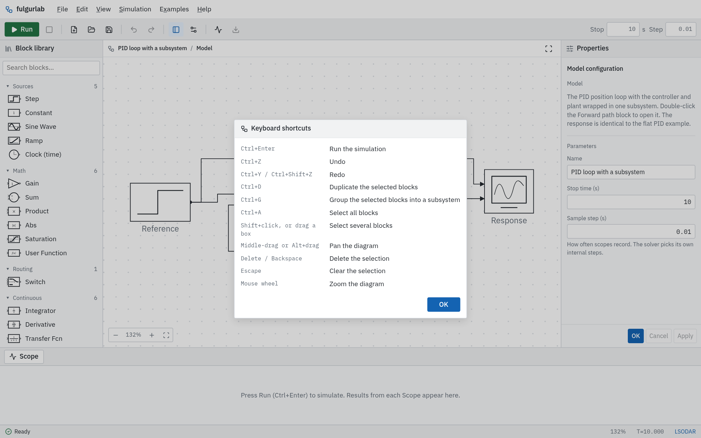

## Limits

| Limit | Value |
|---|---|
| Blocks / wires per model, all levels together | 200 / 400 |
| Subsystem nesting | 4 deep |
| Coefficients per polynomial | 16 |
| Samples per scope / per run | 1,000,000 / 2,000,000 |
| Stop time | 10,000 s |
| Time allowed per run | 20 s (the server's default) |

## Two more things

**Dark mode** follows your system setting.

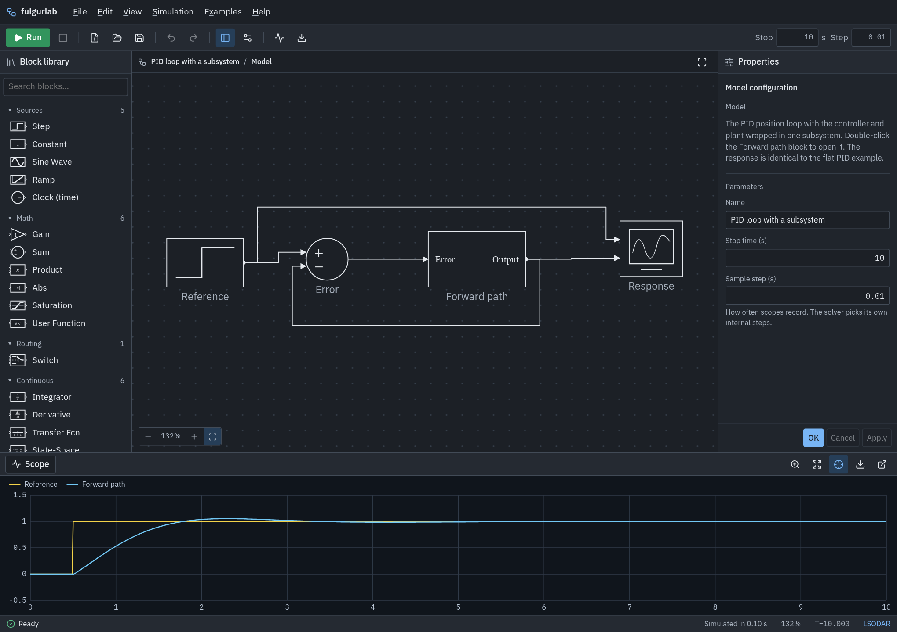

**Embedded mode** (`?embed=1`, or inside an iframe) hides the menu bar and the new, open and save buttons, for use inside another site. [embedding.md](embedding.md) explains how to connect it.

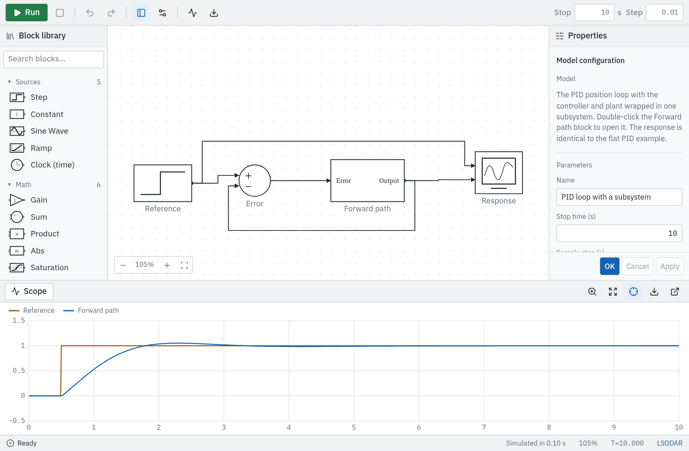

